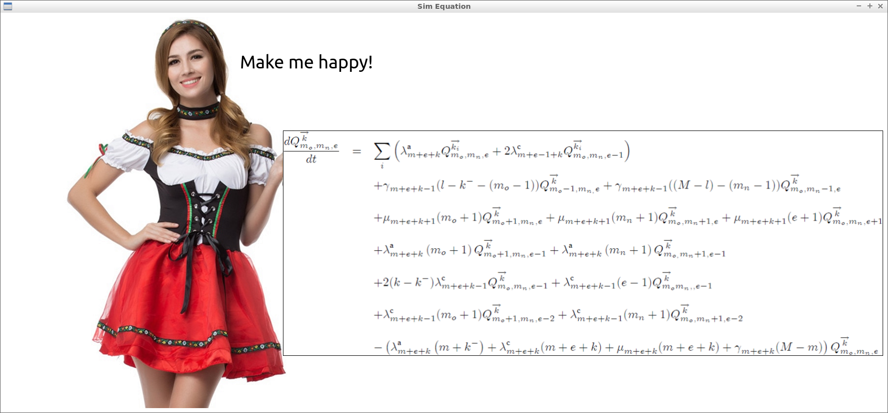

# Sim Equation

Sim Equation is an equation simulator game
and one of [Richèl Bilderbeek's games](https://richelbilderbeek.github.io/games)

Equations are beautiful. Let's simulate the joy equations bring!

- [Play the game in your browser](play.md)
- [Download the Windows version](https://richelbilderbeek.github.io/sim_equation/sim_equation_windows.zip): unzip it and run `sim_equation.exe`

## Links

- [Beer Sim](https://github.com/richelbilderbeek/beer_sim): similar equally important simulation
